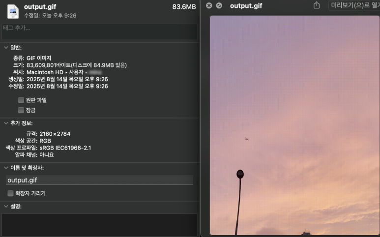
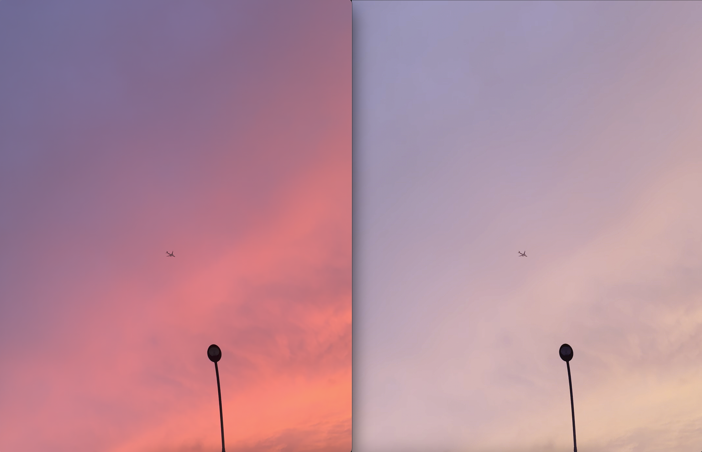
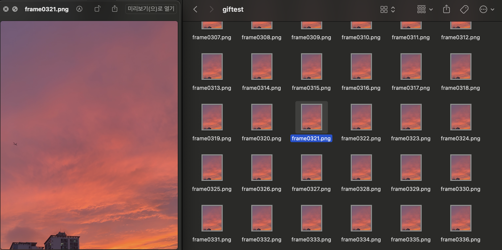
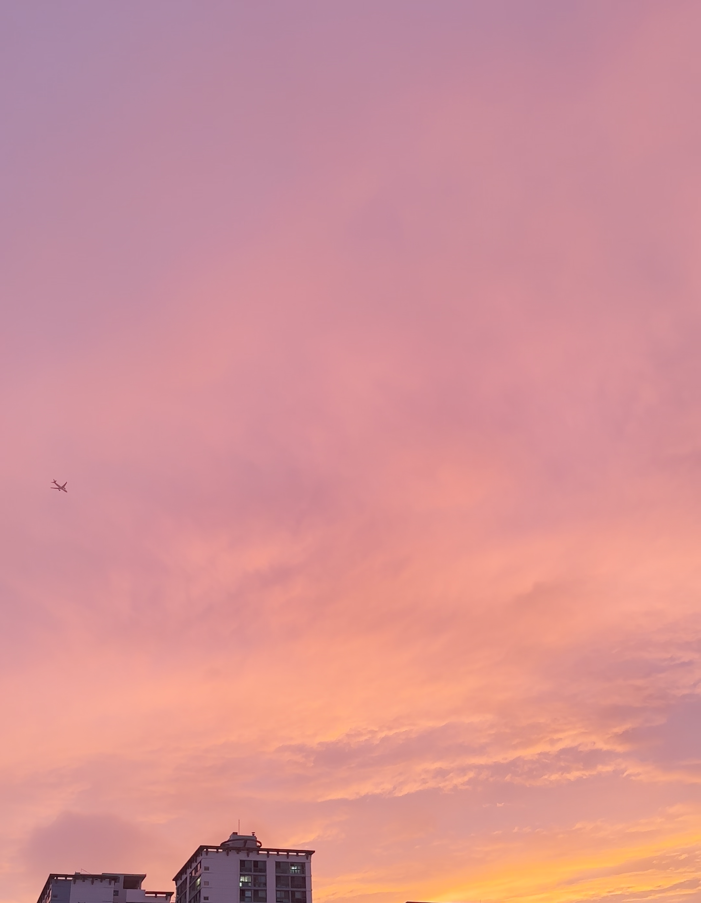
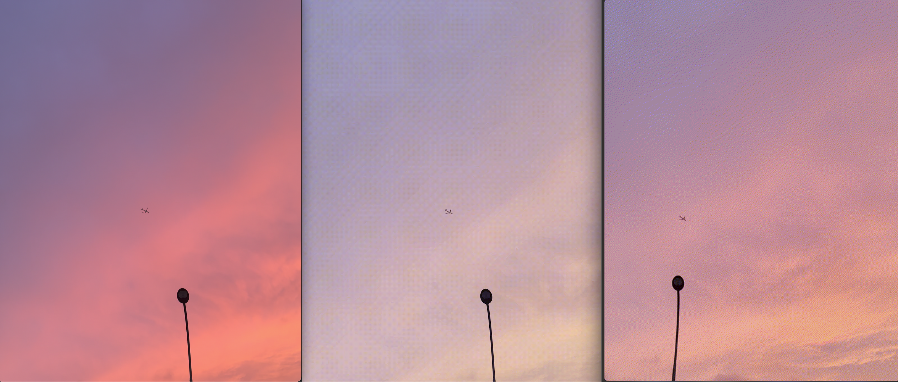
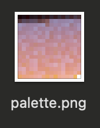
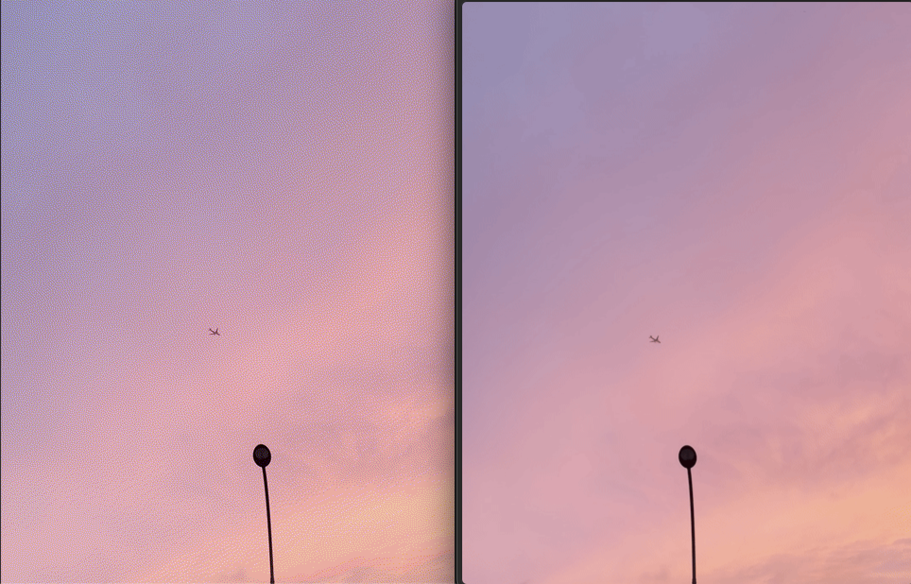
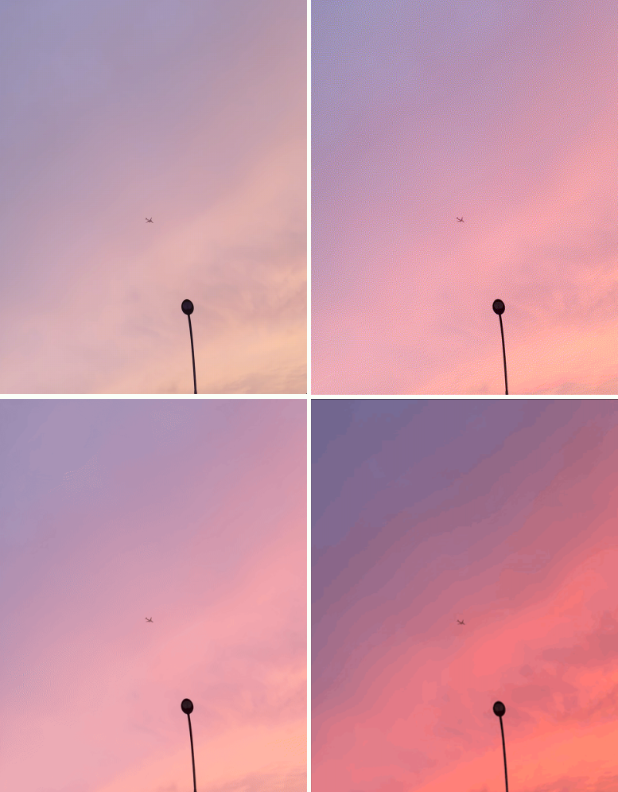

> git commit -m "Quest for the ultimate GIF, part 2"

If turning video into GIFs were a movie, FFmpeg would be the main character's best friend. In this post I'll look at what FFmpeg is and then use it to make some GIFs.

## What is FFmpeg?

**Fast Forward MPEG**

FFmpeg is an open-source multimedia framework that lets you do pretty much anything you want with video and audio data.

It reads and writes almost every format out there, including MP4, MOV, MKV, AVI, WebM, and HLS. It's a do-it-all tool that handles converting, extracting, encoding, decoding, cutting, filters, and even streaming.

In fact, big global services like **YouTube, Instagram, and Netflix** make heavy use of FFmpeg or FFmpeg-based tools in their internal systems.

### What FFmpeg can do

| Feature           | Description                                                              |
| ----------------- | ------------------------------------------------------------------------ |
| Encoding          | Compress a video or convert it to another format (e.g. mp4 → webm)       |
| Decoding          | Interpret encoded video so it can be played back                         |
| Frame extraction  | Pull images (frames) out of a video                                      |
| Cutting/joining   | Cut or join video and audio                                              |
| Filters           | Adjust brightness, add subtitles, rotate, convert color space, and more  |
| Streaming         | Set up a live video streaming server (HLS, RTMP, etc.)                   |

For starters, let's use FFmpeg to convert an MP4 video into a GIF.

## Trying out FFmpeg

You can download it from the [official FFmpeg website](https://ffmpeg.org), but I installed it on my MacBook with Homebrew.

### Installing FFmpeg on a Mac

```bash
brew install ffmpeg
```

## Making GIFs with FFmpeg

There are several ways to make a GIF with FFmpeg. I tried four different methods in total, and it was fun seeing each one come out differently.

### Method 1) Basic conversion: MP4 to GIF

```bash
ffmpeg -i input.mp4 output.gif
```

Run the command above to create a basic GIF. This is the most standard way to do it.

**Result**: 83.6MB


That gave me a GIF weighing in at 83.6MB.



But you can tell right away that the colors are pretty far off from the original, right? The one on the right is kind of pretty in its own way, haha, but the goal is a GIF with colors as close to the video as possible.

Next, I tried making the GIF in two steps.

### Method 2-1) Extract PNGs first, then make the GIF

```bash
ffmpeg -i input.mp4 -vf "zscale=primaries=bt709:m=bt709:range=full" -pix_fmt rgb24 frame%04d.png
```

This command uses FFmpeg to pull frames out of the original video as images (PNG) while converting the color space.

In short, the command above:

1. Uses the zscale filter for color accuracy and keeps the full color range
2. Extracts the MP4 video frame by frame as 24-bit RGB TrueColor PNGs



⚠️ **Note**: Make a separate test folder and run this command in there! It generates a huge number of image files.



A whole bunch of PNG images with decent colors came pouring out.

### Method 2-2) Combine the PNG frames into a GIF

```bash
ffmpeg -framerate 15 -i frame%04d.png -vf "scale=480:-1:flags=lanczos" output.gif
```

This command takes the PNG sequence (frame images) extracted above and turns it into a high-quality GIF at 15 frames per second.

**Result**: 35.6MB

This gives you a pretty decent GIF.


The one on the far right is the GIF I just made.

### Method 3) Generate a palette, then make the GIF ⭐

This time, I first generate a **"palette image."**

```bash
ffmpeg -i input.mp4 -vf "fps=15,scale=480:-1:flags=lanczos,zscale=primaries=bt709:m=bt709:range=full,palettegen" palette.png
```

Run the command above and you get a 16px palette image like this one:



That's the palette image.
I'll use this palette to make the GIF.

#### Why do you need a palette?

Remember how GIF can only show 256 colors? On top of that, the 256 colors get picked separately for each frame, so the colors come out unstable.

To make up for that, **you pick 256 colors based on every frame of the whole video and build a palette from them (palettegen).**

```bash
ffmpeg -i input.mp4 -i palette.png -filter_complex "fps=15,scale=480:-1:flags=lanczos,zscale=primaries=bt709:m=bt709:range=full[x];[x][1:v]paletteuse" output.gif
```

Now let's apply that palette and make the GIF.

**Result**: 8.8MB (down from 35.6MB to 8.8MB!)



You can really see the difference when you look at the actual GIF! The colors are much closer to the video. And the file size dropped even further, from 35.6MB to 8.8MB.

### Method 4) Naver Blog app


**Result**: 768KB

Last up is a GIF made with the Naver Blog app (the blogging app from Naver, Korea's biggest portal), which is known for really nice colors.

It's the smallest file, but then again, it only lets you make short clips in the first place.

## Wrap-up: comparing the 4 methods



Ta-da! After all that work, **Naver Blog still has the best colors.** Figures.

But look how harsh those color boundaries are. So close.

## But then...

So, what do you think of this one?


The ultimate GIF - 4.2MB
**Pretty great, right? This is the ultimate GIF.** 😄 And the file size is reasonable too.

But the secret behind this result wasn't FFmpeg. It turns out some genius developer built a GIF tool for exactly this.

I wrote about it in the next post. → [gifski: Getting Past GIF's 256-Color Limit]()

**Hint**: per-frame palette optimization + temporal dithering + some magic that makes it look like the 256-color limit just isn't there! 🎨
