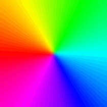
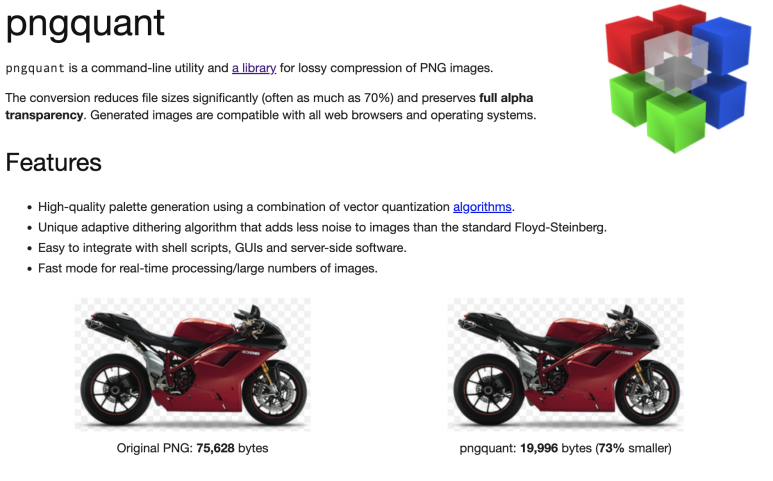
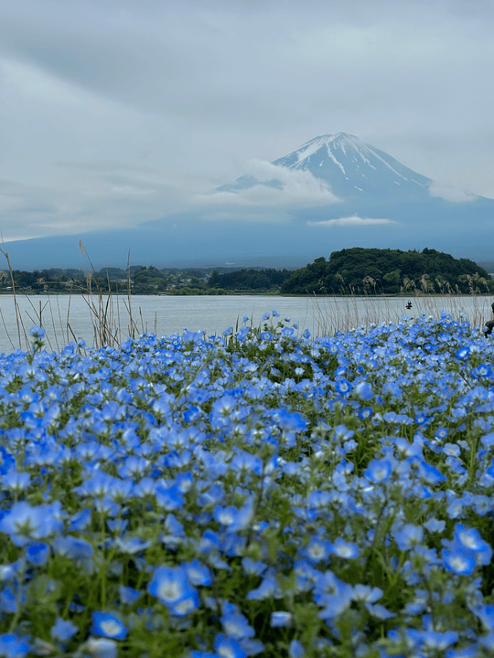
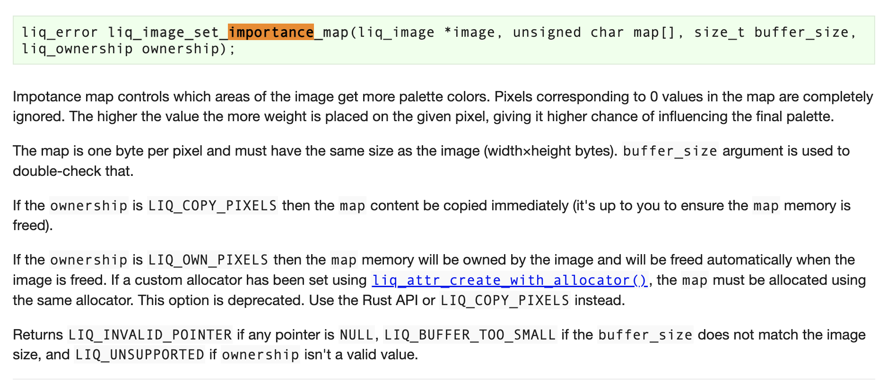
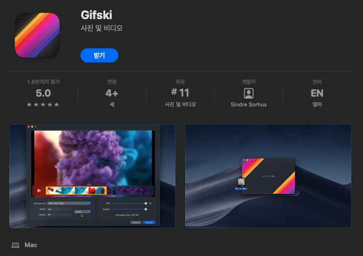

> In my last post, I walked through converting video to GIF with FFmpeg.

**Previous post**: [How to Turn Videos into High-Quality GIFs with FFmpeg]()

But the GIFs I made with FFmpeg still left something to be desired: the colors were flat and the motion wasn't smooth.

So this time I'll introduce **gifski, a high-quality GIF encoder** that fixes those problems, and go over its three core techniques and how it differs from FFmpeg.

I'll also share a GIF converter site that uses this technology.

🔗 **[Video to GIF - High-quality GIF converter that runs in your browser](https://videotogif.github.io/en/)**

It uses a technology called "gifski" to turn videos into really good-quality GIFs. <br>
If you're curious how it works, read on! 😀

## 1. What is gifski?

🔗 [https://gif.ski](https://gif.ski)

**gifski is a technology that seems to break through GIF's limit of only 256 colors.**



Instead of the usual GIF approach of handling every frame with one palette, it **makes a new palette for each frame** and **coordinates noise patterns between frames**, so colors look rich even within the 256-color limit.

Let me explain how it works in a bit more detail.

## 2. Gifski's core techniques

### 2-1. High-quality palettes

**Generating "high-quality palettes" with libimagequant/pngquant**

The first key to how Gifski makes GIFs is that it builds each frame's palette with **libimagequant** (the engine behind pngquant).

#### What is libimagequant?

Put simply, when you convert an image with millions of colors into a 256-color palette image, it finds the 256-color palette with the least error, so the result looks almost identical to the original.



Turns out this engine can shrink PNG files this much, too!

A GIF can only use up to 256 colors per frame. Now picture a real-life sunset with hundreds of thousands to millions of colors, painted:

- by me, with 256 colors grabbed out of a crayon box
- by a master with a PhD in color science, with 256 hand-picked colors

The results would be pretty different, right?

#### Hands-on test: what libimagequant can do

Let's get a feel for why libimagequant is a color master with the test below.


Mt. Fuji, shot by yours truly :)
Here's a 540px landscape photo. I'll test two versions with it.

**a) Regular quantization (256 colors picked by me)**

```bash
brew install imagemagick  # install imagemagick

magick sunset_540.png -colors 256 -dither FloydSteinberg naive_256.png
```

The command above runs ImageMagick's built-in color quantization algorithm on the sample image to:

1. Pick 256 colors that represent the whole image
2. Remap every pixel to one of those 256 colors
3. Apply Floyd-Steinberg dithering


That's the naive quantization example.
It's fast and simple, but looking at the result, you can see the sky and sunset getting squashed (banding).

**b) libimagequant-based pngquant (the color master)**

```bash
brew install pngquant  # install pngquant

pngquant --force --speed 1 --quality 70-100 --output liq_256.png 256 sunset_540.png
```

This time the libimagequant engine optimizes the 256-color palette first, then generates the image.



The libimagequant quantization example.

**The image comes out way more natural!**

#### Importance Map



libimagequant also has a feature called **importance map**. It gives extra weight to important pixels like faces or text and uses that to decide which colors get priority in the palette.

```c
liq_image_set_importance_map()
```

So even with the same 256 colors, things look better.

### 2-2. Cross-frame palettes (per-frame optimization)

GIF allows not just a global palette but also local palettes, meaning a palette per frame. If a frame has a local palette, that frame uses it.

**gifski**:

1. Builds a local palette (LCT) for each frame with libimagequant
2. Reuses some colors by looking at the color distribution of the previous and next frames
3. Keeps the same areas on similar palette colors even as frames change

That way it applies **cross-frame optimization that cuts down on colors jumping around**.

As a result, colors don't flicker from frame to frame, and everything looks smooth.

#### Checking which palettes a GIF uses

```bash
gifsicle --info your_file.gif
```

You can check a GIF's frame info with the command above.

**1) gifski.gif**


```
* 57 images
  logical screen 450x580
  global color table [2]
  background 0
  loop forever
  + image #0 450x580
    comment gif.ski
    local color table [256]
    disposal asis delay 0.10s
  + image #1 450x580 transparent 0
    local color table [256]
    disposal asis delay 0.10s
  + image #2 450x580 transparent 0
    local color table [256]
    disposal asis delay 0.10s
  ...
```

You can see that the GIF made by gifski has **its own LCT (256 colors) attached to every frame**. With `disposal asis`, it keeps the previous frame and draws the next one on top of it, so it makes use of leftover pixels and layering.

This lets it optimize colors frame by frame, so it can show more natural colors across all kinds of scenes.

**2) ffmpeg.gif**


```
logical screen 480x618
  global color table [256]
  background 255
  loop forever
  + image #0 480x618 transparent 255
    local color table [256]
    disposal asis delay 0.07s
  + image #1 480x618 transparent 255
    disposal asis delay 0.06s
  ...
```

This one has a mixed structure: a 256-color global palette (GCT), with an LCT on the first frame only. Since it mostly relies on the global palette, image quality drops when the scene changes a lot, with lost colors and so on.

**3) naver.gif**


```
logical screen 388x500
  global color table [256]
  background 0
  loop forever
  + image #0 388x500 transparent 255
    disposal background delay 0.10s
  + image #1 388x500 transparent 255
    disposal background delay 0.10s
  ...
```

This is a GIF made with the Naver Blog app (Naver is Korea's biggest portal). It uses only a 256-color global palette, no local palettes. (Hmm... I wonder how Naver picks its global palette colors 🤔)

### 2-3. Temporal dithering

Last up is **temporal dithering**.

Before getting into that, a quick word on regular image dithering: it's a technique for showing a wider range of colors using a limited color palette.

> 💡 **Note**: [What is dithering? Types of image dithering](https://sudo-minz.tistory.com) (in Korean) - I found a page that explains it well, so I'm linking it here.

Dithering usually mixes pixel patterns inside a single frame, but **gifski stretches it across time (multiple frames).**

| Regular spatial dithering                              | Temporal dithering                                                                     |
| ------------------------------------------------------ | -------------------------------------------------------------------------------------- |
| Mixes pixels within one frame to create in-between tones | Shifts the dithering pattern slightly from frame to frame so you perceive more colors |

#### How temporal dithering works

Our eyes and brain tend to lump together light that comes in over a short span of time.

So if you flash red and blue back and forth really fast, you can't tell the two colors apart and **see purple instead**. gifski uses this to get you to perceive more colors.

## 3. FFmpeg vs. Gifski: the differences


### FFmpeg's basic pipeline

Picks one 256-color global palette and applies it to every frame

### gifski's pipeline

Out of the box, it uses:

- ✅ Per-frame palettes
- ✅ Cross-frame consistency
- ✅ Temporal dithering

As a result, **color reproduction gets noticeably better, even with the same 256-color limit.**

## gifski's big drawback

But gifski had one pretty serious drawback...



You **can't just use it quickly** the way you can with ezgif or the Naver app. Sigh.

First, you have to install an app from the App Store.

I'm not a big fan of installing programs... and I don't love that uneasy feeling of not knowing where stuff gets saved, either.

## So I built my own

**So I made my own site where the files I upload aren't stored anywhere, the quality is good, and conversion doesn't take long.**

**[Video to GIF - High-quality GIF converter that runs in your browser](https://videotogif.github.io/en/)**

### What Video to GIF offers

- 🔒 **Full privacy**: your files are never uploaded to a server
- ⚡ **Fast conversion**: everything is processed locally in your browser
- 🎨 **High quality**: powered by gifski
- 💰 **Free**: nothing to install, no sign-up

I built it so anyone can use it without reading a manual, but I'll go into more detail about the site in the next post!

---

## Wrapping up

Thanks for reading all the way through this long one. 🙌

**Summary**:

- gifski gets past the 256-color limit with per-frame palettes and temporal dithering
- libimagequant generates the best possible palettes
- Its color reproduction beats FFmpeg's
- I built Video to GIF so you can use it right in your browser
