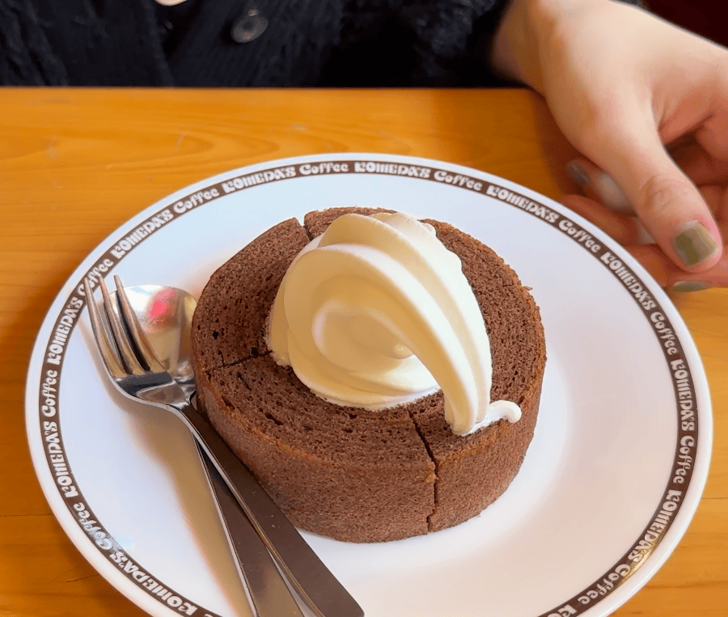
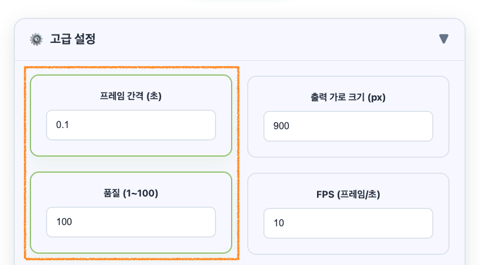

> I've written several posts about settings over time, but when I reread them, they overlapped and some of them were wrong. One even said a lower quality number means higher quality. It's the other way around. Sorry for the confusion. So I rewrote everything into this one post, based on how the code actually works.
>
> **Update, November 2026:** You no longer type these values into the converter. It now picks them automatically for each video's length and resolution, and you just choose a level on one slider (Low-spec to High-spec). Read this post as an explanation of what each value changes behind the scenes. The comparison GIFs and the screenshot below were made with the older version, where you entered the values yourself.

## Results first

<div class="gif-compare">
  <figure>
    
    <figcaption>Old defaults, untouched (15 frames, 1.5s, 4.5MB)</figcaption>
  </figure>
  <figure>
    
    <figcaption>Only two values changed (45 frames, 4.5s, 14MB)</figcaption>
  </figure>
</div>

Both come from the same 4.5-second video. The left one is what the older version gave you if you didn't touch anything. The right one is what you got after changing just two values in Advanced Settings.



The two changes were Frame Interval (0.3 → 0.1 seconds) and Quality (90 → 100). Why the left one looks weirdly fast-forwarded is the whole point of this post, so let me go through the settings one at a time.

## Frame Interval: how often to grab a frame from the original

The converter goes through the video from start to finish, skipping ahead by this interval and capturing a frame each time. At 0.3 seconds, that's 0s, 0.3s, 0.6s, and so on. So this setting pretty much decides how many frames end up in your GIF.

```
Frames ≈ video length ÷ frame interval

4.5s video, 0.3s interval → 15 frames
4.5s video, 0.1s interval → 45 frames
```

A shorter interval makes the motion smoother, and the file gets bigger with the extra frames. The shortest interval you could pick in the old version was 0.1 seconds; now the High-spec level captures as densely as every 0.04 seconds (25 frames per second).

## FPS: how many of those frames to show per second

FPS is used when the GIF plays, not when frames are captured. The frame count stays the same; only the speed at which the frames flip by changes. At first I also assumed a lower FPS would make the file smaller, but in this converter it doesn't. These two are the proof.

<div class="gif-compare">
  <figure>
    
    <figcaption>0.1s interval + FPS 5 (9s, 14MB)</figcaption>
  </figure>
  <figure>
    
    <figcaption>0.1s interval + FPS 20 (2.25s, 14MB)</figcaption>
  </figure>
</div>

Both have 45 frames, and both are exactly 14MB. The only difference is that the left one plays in slow motion and the right one plays at 2x speed.

## Why you need to look at both together: playback speed

Frame interval multiplied by FPS gives you the playback speed. This is where people get confused the most.

```
Playback speed = frame interval × FPS

0.1s × 10fps = 1x (original speed)
0.3s × 10fps = 3x (old default)
0.2s × 5fps  = 1x (original speed, but choppier)
```

The old defaults played three times faster than the original. For short meme clips that can actually be kind of fun, but not when speed matters, like in a screen recording. So the automatic settings now always set FPS to `1 ÷ interval`, and every level plays at the original speed (the only exception is a video so long the browser's memory can't keep up). A 0.1s interval means FPS 10, 0.2s means 5, and so on.

## Comparison table

Every GIF in this post was made from the same 4.5-second video, converted at 900px wide. Here are the frame count, playback length, and file size for each:

| Frame Interval | FPS | Frames | Playback Length | File Size |
| :---: | :---: | :---: | :---: | :---: |
| 0.1s | 5 | 45 | 9.0s (0.5x speed) | 14.0MB |
| 0.1s | 10 | 45 | 4.5s (original speed) | 14.0MB |
| 0.1s | 20 | 45 | 2.25s (2x speed) | 14.0MB |
| 0.2s | 5 | 23 | 4.6s (original speed) | 7.5MB |
| 0.3s | 3 | 15 | 5.0s (close to original speed) | 5.0MB |
| 0.5s | 10 | 9 | 0.9s (5x speed) | 3.0MB |
| 1s | 10 | 5 | 0.5s (10x speed) | 1.7MB |

As you can see, file size follows the frame count no matter what the FPS is. Going from a 0.1s interval to 0.2s cut both the frame count and the file size almost in half.

Here's what happens if you match the original speed and only stretch the interval (for 0.3s, FPS had to be a whole number, so 3 was the closest). You can see the motion getting choppier.

<div class="gif-compare">
  <figure>
    
    <figcaption>0.1s + FPS 10 (14MB)</figcaption>
  </figure>
  <figure>
    
    <figcaption>0.2s + FPS 5 (7.5MB)</figcaption>
  </figure>
  <figure>
    
    <figcaption>0.3s + FPS 3 (5.0MB)</figcaption>
  </figure>
</div>

## Output Width

This is the setting that affects file size the most. When you reduce the width, the height shrinks proportionally too, so the pixel count drops with the square. Going from 800px to 400px leaves you with a quarter of the pixels.

Now the longer side is set by the quality level, from 320px (Low-spec) up to 900px (High-spec). I wrote [a separate post]() about why it stops at 900px. Making it bigger than the original doesn't really do anything, since it can't add detail that wasn't there.

## Quality (1~100)

Higher means better quality, and it's now set by the level, from 70 (Low-spec) to 100 (High-spec). This value is passed straight to the GIF encoder (gifski). Lowering it makes the encoder cut colors more aggressively and use more noise, and in exchange the file gets smaller.

Screen recordings with simple colors usually don't show much difference when you lower the quality, but videos with lots of gradients, like sunsets or skin, show it right away. That's why the automatic settings adjust size and frame count before quality.

## What to cut first when the file is too big

1. **Shorten it first.** The frame count goes up with the length, so this works the most reliably. You can also put the finished GIF into [Trim GIF](/en/gif-trim/) and keep only the part you need.
2. **Move the quality slider toward Low-spec.** Each step down lowers both the width and the frames per second. Width counts twice because the effect is squared, and halving the frame count roughly halves the file.

As shown above, changing FPS alone doesn't shrink the file, so the automatic settings always move the capture interval and FPS together.

## Which level to pick

There isn't one right answer, so here are levels that work well as a starting point.

| Use | Level | Why |
| --- | :---: | --- |
| Quick memes for chat | Low-spec to Lighter | Small and fast to make |
| Screens for blogs and docs | Balanced | Reasonable size and weight |
| Screen recordings with small text, bug reports | Sharper | The text has to be readable |
| Portfolios, presentations | High-spec | Best after trimming the clip short |

When I first wrote this, 10 frames per second was the most this converter could do at original speed, and I said I'd add denser capture "later on". High-spec now captures up to 25 frames per second at original speed.

Upload limits are different for every social network and messaging app, and they change often, so I didn't list numbers here. Check the service's help page once before you upload.

## Adding text

If you type something into Text Settings and generate the GIF again, you can drag the text around on the finished GIF to move it. The defaults (white text, black background, 0.6 opacity) look fine in most cases. For font size, I recommend around 30~50px so the text is still readable when the GIF is displayed smaller.

## In short

- Frames = length ÷ interval, playback speed = interval × FPS
- To shrink the file: trim the length first, then move the slider toward Low-spec
- The converter now picks these values for each video automatically

I covered why GIF colors come out duller than the original, and why this converter uses gifski, in my dev log series.

- [1. The Limits of GIF and My Search for a Better Converter]()
- [2. How to Turn Videos into High-Quality GIFs with FFmpeg]()
- [3. gifski: Getting Past GIF's 256-Color Limit]()
