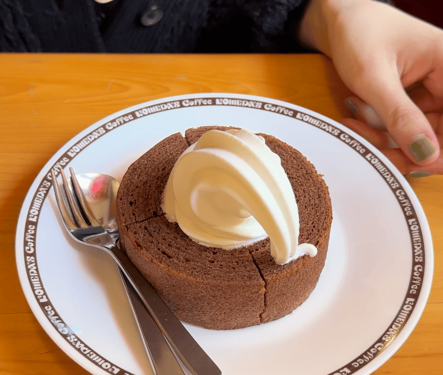
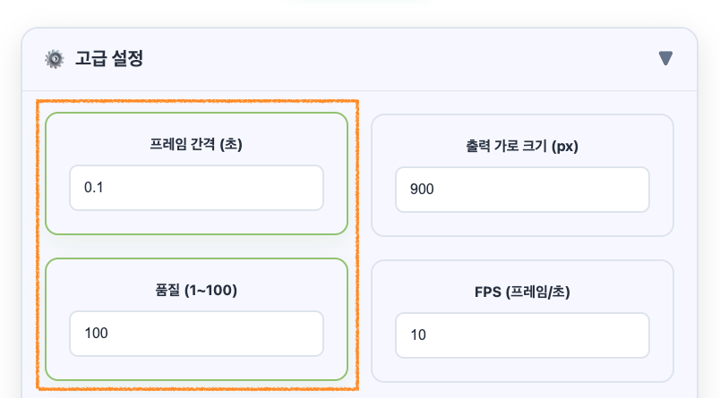

> 그동안 설정 관련 글을 여러 편 올렸는데, 다시 읽어보니 내용이 겹치고 틀린 곳도 있었습니다. 품질 숫자가 낮을수록 고화질이라고 적은 글도 있었는데, 반대입니다. 헷갈리게 해서 죄송해요. 그래서 실제 코드가 어떻게 동작하는지를 기준으로 이 글 하나에 다시 정리했습니다.

## 먼저 결과부터

<div class="gif-compare">
  <figure>
    
    <figcaption>기본값 그대로 (15장, 1.5초, 4.5MB)</figcaption>
  </figure>
  <figure>
    
    <figcaption>두 값만 바꾼 결과 (45장, 4.5초, 14MB)</figcaption>
  </figure>
</div>

같은 4.5초짜리 영상입니다. 왼쪽은 업로드하고 아무것도 안 건드린 결과고, 오른쪽은 고급 설정에서 두 값만 바꾼 결과예요.



바꾼 건 프레임 간격(0.3 → 0.1초)과 품질(90 → 100)입니다. 왼쪽이 묘하게 빨리 감기처럼 보이는 이유가 이 글의 핵심이라, 하나씩 설명해 볼게요.

## 프레임 간격: 원본에서 몇 초마다 한 장씩 뽑을지

변환기는 영상을 처음부터 끝까지 이 간격만큼 건너뛰면서 장면을 캡처합니다. 0.3초라면 0초, 0.3초, 0.6초… 이런 식이에요. 그래서 GIF에 들어가는 장수는 거의 이걸로 정해집니다.

```
장수 ≈ 영상 길이 ÷ 프레임 간격

4.5초 영상, 간격 0.3초 → 15장
4.5초 영상, 간격 0.1초 → 45장
```

간격을 줄이면 움직임이 촘촘해지고, 늘어난 장수만큼 용량도 커집니다. 이 변환기에서 고를 수 있는 가장 짧은 간격은 0.1초예요.

## FPS: 뽑아 둔 장면을 1초에 몇 장씩 넘길지

FPS는 캡처할 때가 아니라 재생할 때 쓰는 값입니다. 장수는 그대로 두고 넘기는 속도만 바꿔요. 저도 처음에는 FPS를 낮추면 파일이 작아질 줄 알았는데, 이 변환기에서는 그렇지 않습니다. 아래 두 개가 그 증거예요.

<div class="gif-compare">
  <figure>
    
    <figcaption>간격 0.1초 + FPS 5 (9초, 14MB)</figcaption>
  </figure>
  <figure>
    
    <figcaption>간격 0.1초 + FPS 20 (2.25초, 14MB)</figcaption>
  </figure>
</div>

둘 다 45장이고 용량도 똑같이 14MB입니다. 왼쪽은 느린 화면, 오른쪽은 2배속이 됐을 뿐이에요.

## 둘을 같이 봐야 하는 이유: 재생 속도

간격과 FPS를 곱한 값이 곧 재생 배속입니다. 여기서 제일 많이 헷갈려요.

```
재생 배속 = 프레임 간격 × FPS

0.1초 × 10fps = 1배 (원본 속도)
0.3초 × 10fps = 3배 (기본값)
0.2초 × 5fps  = 1배 (원본 속도, 대신 장면이 듬성듬성)
```

기본값은 원본보다 세 배 빠르게 돌아갑니다. 짧은 짤은 그게 오히려 재밌을 때도 있지만, 화면 녹화처럼 속도가 중요하면 맞춰 주는 게 좋아요. 원본 속도로 만들려면 FPS를 `1 ÷ 간격`으로 넣으면 됩니다. 간격이 0.1초면 FPS 10, 0.2초면 5, 0.5초면 2예요.

## 직접 비교해 본 표

이 글에 쓴 GIF들은 모두 같은 4.5초 영상을 가로 900px로 변환한 파일입니다. 장수, 재생 길이, 용량을 정리하면 이렇습니다.

| 프레임 간격 | FPS | 장수 | 재생 길이 | 용량 |
| :---: | :---: | :---: | :---: | :---: |
| 0.1초 | 5 | 45 | 9.0초 (0.5배속) | 14.0MB |
| 0.1초 | 10 | 45 | 4.5초 (원본 속도) | 14.0MB |
| 0.1초 | 20 | 45 | 2.25초 (2배속) | 14.0MB |
| 0.2초 | 5 | 23 | 4.6초 (원본 속도) | 7.5MB |
| 0.3초 | 3 | 15 | 5.0초 (원본 속도) | 5.0MB |
| 0.5초 | 10 | 9 | 0.9초 (5배속) | 3.0MB |
| 1초 | 10 | 5 | 0.5초 (10배속) | 1.7MB |

보시다시피 용량은 FPS와 상관없이 장수를 따라갑니다. 간격을 0.1초에서 0.2초로 늘렸더니 장수도 용량도 거의 절반이 됐어요.

원본 속도를 유지한 채 간격만 늘리면 이렇게 됩니다. 장면이 점점 듬성듬성해지는 게 보여요.

<div class="gif-compare">
  <figure>
    
    <figcaption>0.1초 + FPS 10 (14MB)</figcaption>
  </figure>
  <figure>
    
    <figcaption>0.2초 + FPS 5 (7.5MB)</figcaption>
  </figure>
  <figure>
    
    <figcaption>0.3초 + FPS 3 (5.0MB)</figcaption>
  </figure>
</div>

## 출력 가로 크기

용량에 제일 크게 듣는 값이에요. 가로를 줄이면 세로도 비율대로 같이 줄어서, 픽셀 수는 제곱으로 줄어듭니다. 800px를 400px로 줄이면 픽셀은 4분의 1이에요.

업로드하면 원본 가로 크기로 자동으로 맞춰지고, 최대는 900px입니다. 왜 900px에서 막아 뒀는지는 [따로 글]()을 써 뒀어요. 원본보다 크게 키우는 건 의미가 없습니다. 없던 디테일이 생기지는 않으니까요.

## 품질 (1~100)

숫자가 클수록 고화질이고, 기본값은 90입니다. 이 값은 GIF 인코더(gifski)에 그대로 넘어가요. 낮추면 색을 더 과감하게 줄이고 노이즈를 더 쓰는 대신 용량이 줄어듭니다.

색이 단순한 화면 녹화는 품질을 낮춰도 티가 잘 안 나는 편이고, 노을이나 피부처럼 그라데이션이 많은 영상은 금방 티가 납니다. 그래서 품질은 마지막에 건드리는 게 좋아요.

## 용량이 너무 클 때 줄이는 순서

1. **길이부터 줄이기.** 장수가 길이에 비례하니까 가장 확실합니다. 만든 GIF를 [GIF 자르기](/gif-trim/)에 올려서 필요한 구간만 남겨도 돼요.
2. **가로 크기 줄이기.** 효과가 제곱으로 들어옵니다.
3. **프레임 간격 늘리기.** 0.1초를 0.2초로 바꾸면 장수가 절반이 돼요. 속도를 유지하려면 FPS도 같이 절반으로 낮추세요.
4. **그래도 크면 품질 낮추기.**

FPS는 용량 줄이는 데는 도움이 안 되니, 속도를 맞출 때만 쓰시면 됩니다.

## 상황별 시작값

딱 정해진 정답은 없어서, 처음 시작할 때 쓰기 좋은 값만 적어 둘게요.

| 용도 | 프레임 간격 | FPS | 가로 크기 |
| --- | :---: | :---: | :---: |
| 버그 리포트, 화면 녹화 | 0.2초 | 5 | 원본 (글자가 읽혀야 하니까) |
| 짤, 리액션 | 0.1초 | 10 | 400~480px |
| 최대한 부드럽게 | 0.1초 | 10 | 영상을 짧게 자르고 크기를 줄여서 |
| 타임랩스처럼 빠르게 | 0.5초 | 10 | 자유 |

원본 속도 기준으로는 0.1초 + FPS 10이 이 변환기에서 낼 수 있는 가장 부드러운 설정입니다. 더 촘촘하게 뽑는 기능은 나중에 추가해 보려고 해요.

SNS나 메신저마다 올릴 수 있는 용량이 다르고 자주 바뀌어서, 여기에 숫자로 적어 두지는 않았습니다. 올리기 전에 해당 서비스 도움말을 한 번 확인해 주세요.

## 텍스트를 넣을 때

텍스트 설정에 글자를 넣고 다시 만들면, 결과 GIF 위에서 글자를 끌어서 위치를 옮길 수 있습니다. 기본값(흰 글자, 검은 배경, 투명도 0.6)이 대부분 무난해요. 글자 크기는 GIF가 작게 축소돼서 보일 때도 읽히도록 30~50px 정도를 추천합니다.

## 한 줄 정리

- 장수 = 길이 ÷ 간격, 재생 배속 = 간격 × FPS
- 용량은 길이 → 가로 크기 → 간격 순으로 줄이기
- 품질은 클수록 좋고, 마지막에 건드리기

GIF 색이 왜 원본보다 탁해지는지, 이 변환기가 왜 gifski를 쓰는지는 개발기에 정리해 두었어요.

- [1. GIF의 한계와 더 나은 변환을 향한 여정]()
- [2. FFmpeg로 동영상을 고화질 GIF로 만드는 법]()
- [3. GIF의 혁신 gifski: 256색 한계를 뛰어넘다]()
