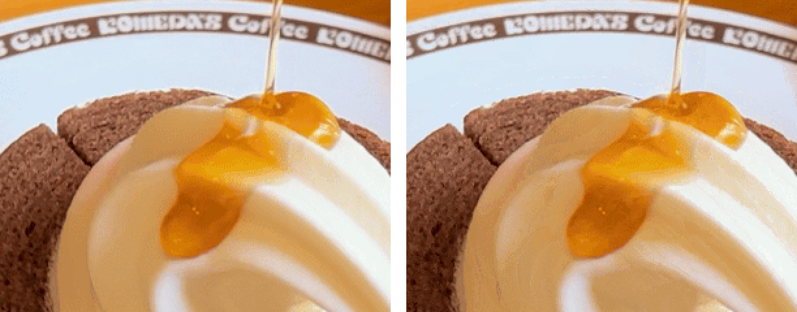
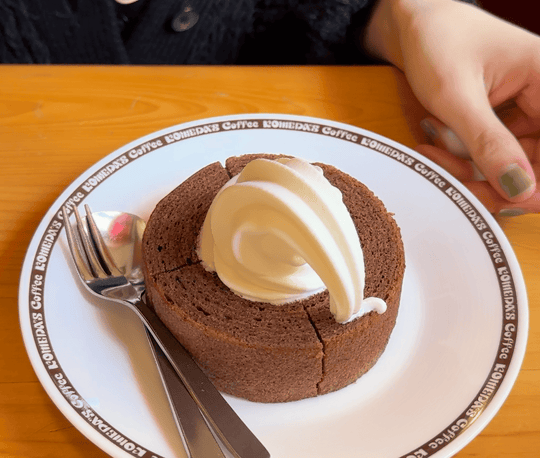

The thing I hear most after someone makes a GIF is "it's too big to upload." Chat apps, GitHub, and pretty much everywhere else have a size limit, and GIFs get big faster than you'd expect.

There's plenty of advice like "make it smaller" or "use fewer frames," but I had never seen numbers for **how much** each of those actually saves. So I tested it myself: same scene, one setting changed at a time, 14 GIFs in total.

## The setup

- Scene: a 4.5-second clip of syrup being poured over a dessert at a café
- Baseline GIF: 900px wide, 10 frames per second (45 frames), quality 100 → **13.98MB**
- Encoder: gifski (the WebAssembly build), the same one this site's converter uses

Instead of the original video, I reused the 45 frames from the GIF I made for the [settings guide](/en/blog/gif-settings-guide/). So the exact numbers may differ a little from what you'd get starting from the video, but they're more than good enough to compare how much each change saves.

## One change at a time

| What changed | File size | Saved |
|---|---|---|
| Baseline (900px · 10 fps · quality 100 · 4.5s) | 13.98MB | - |
| Quality 90 | 12.58MB | -10% |
| Quality 80 | 10.90MB | -22% |
| Quality 70 | 9.53MB | -32% |
| Width 720px | 9.12MB | -35% |
| Width 540px | 5.20MB | -63% |
| Width 400px | 2.96MB | -79% |
| Width 320px | 1.95MB | -86% |
| 5 fps (23 frames) | 7.70MB | -45% |
| 2 seconds long (20 frames) | 6.03MB | -57% |

Here's what the numbers told me.

### 1. Width matters most

Going from 900 to 540 pixels wide took the file from 14MB down to 5.2MB. GIF file size follows the **number of pixels** almost exactly. When you shrink the width, the height shrinks with it, so the area drops with the square.

```
Width 720 → 64% of the area → 65% of the size
Width 540 → 36% of the area → 37% of the size
Width 400 → 20% of the area → 21% of the size
```

The easy way to remember it: **halve the width and the file is about a quarter of the size.** And think about where the GIF will actually be seen. In a chat bubble or an issue comment, a GIF almost never fills 900 pixels. If it'll show up around 540 pixels wide anyway, making it 540 from the start costs you nothing.

### 2. Length scales exactly

Cutting 4.5 seconds down to 2 gave 6.03MB, right in line with the frame count (45 frames → 20). It's the one change that doesn't touch image quality at all, so I always do it first. Trimming just half a second of dead time from each end saves over 20%. Upload the finished GIF to [Trim GIF](/en/gif-trim/) and keep only the part you need.

### 3. Halving frames per second doesn't halve the file

Going from 10 to 5 frames per second cuts the frame count in half (45 to 23), but the file only shrank by 45%. With more time between frames, each frame differs more from the one before it, so there's more to redraw every time. The motion also starts to look visibly choppy, so frames per second is the thing to touch only after you've tried everything else.

### 4. Quality 70 is harder to spot than you'd think

Dropping quality from 100 to 70 saves 32%. What surprised me was how little I could see. I cropped the same part of the same frame, enlarged it 2×, and put them side by side.



Left is quality 100, right is 70. Where the color changes smoothly, like the cream, the right side shows a bit of banding. That's it. You need a 2× enlargement side by side to notice, and it's even harder to spot in a moving GIF at normal size. I didn't test anything below 70 this time. The lowest quality level on this site is also 70, so that's where I draw the line.

## Combining them

| Combination | File size |
|---|---|
| 540px · quality 90 | 4.58MB |
| 400px · quality 80 | 2.23MB |
| 540px · 5 fps · quality 80 | 2.28MB |
| 320px · 5 fps · quality 70 | 0.77MB |

<div class="gif-compare">
  <figure>
    
    <figcaption>540px · 10 fps · quality 90 (4.6MB)</figcaption>
  </figure>
  <figure>
    
    <figcaption>320px · 5 fps · quality 70 (0.8MB)</figcaption>
  </figure>
</div>

From 14MB down to 0.8MB. The one on the right is a bit choppy, but if you have to get under 1MB, it's perfectly usable.

## The order I shrink things in

1. **Cut the length first.** Zero quality loss. Trimming the dead time at each end alone saves a lot.
2. **Match the width to where it'll be shown.** The biggest win, and no real loss if it'll be displayed small anyway.
3. **Lower quality to 80–70.** Another 30% or so, and hard to see.
4. **Still too big? Lower frames per second.** The motion starts to look choppy, so this goes last.

In the [converter](/en/), these values are picked automatically from your video's length and resolution, and the file size shows up as soon as the GIF is made. If it's too big, move the quality slider one step toward Low-spec. If you want to set things yourself, open Custom settings and pick the size (100–900px), quality, and frames per second (5, 10, 20, or 25) separately.

Every site has its own limit, so I wrote up the ones I use most:

- Discord: [Discord GIF size limits and how to fit them](/en/blog/discord-gif-size-limit/)
- GitHub: [How to add GIFs to GitHub issues and READMEs](/en/blog/github-gif/)

If you'd like to know what each setting means first, start with the [GIF settings guide](/en/blog/gif-settings-guide/).
