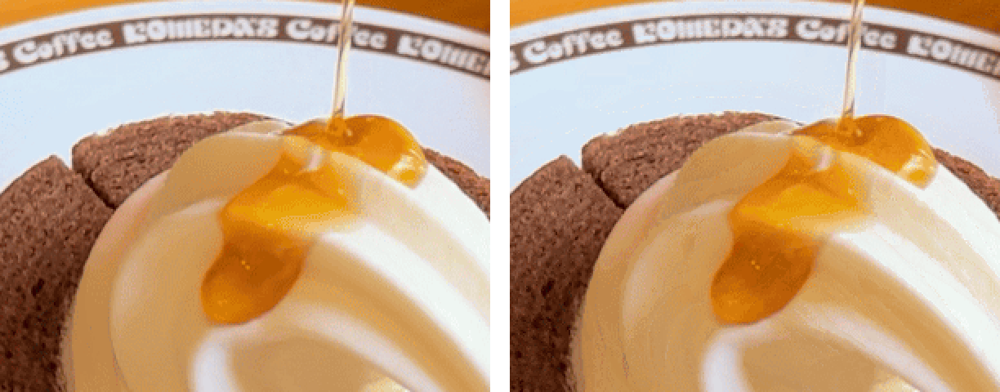
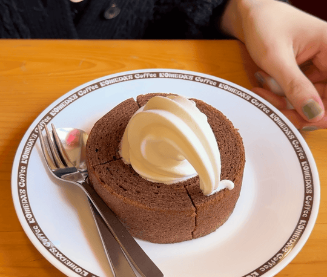

GIF를 만들고 나서 제일 많이 듣는 말이 "너무 커서 안 올라가요"예요. 메신저든 깃허브든 올릴 수 있는 크기가 정해져 있는데, GIF는 생각보다 금방 커지거든요.

"크기를 줄이세요", "프레임을 줄이세요" 같은 조언은 많은데, 그래서 **얼마나** 줄어드는지 숫자로 본 적이 없어서 직접 해 봤습니다. 같은 장면으로 설정만 바꿔 가며 14번 만들었어요.

## 실험 조건

- 장면: 카페에서 디저트에 시럽을 붓는 4.5초 영상
- 기준 GIF: 가로 900픽셀, 초당 10장(45장), 품질 100 → **13.98MB**
- 인코더: 이 사이트 변환기와 같은 gifski(WebAssembly 버전)

원본 영상 대신 [설정 정리 글](/blog/gif-settings-guide/)에서 만들었던 GIF의 장면 45장을 다시 썼어요. 그래서 원본 영상으로 만들 때와 숫자가 조금 다를 수 있지만, 무엇이 얼마나 줄이는지 비율을 보기에는 충분합니다.

## 하나씩 바꿔 본 결과

| 바꾼 것 | 결과 용량 | 줄어든 정도 |
|---|---|---|
| 기준 (900px · 10장/초 · 품질 100 · 4.5초) | 13.98MB | - |
| 품질 90 | 12.58MB | -10% |
| 품질 80 | 10.90MB | -22% |
| 품질 70 | 9.53MB | -32% |
| 가로 720px | 9.12MB | -35% |
| 가로 540px | 5.20MB | -63% |
| 가로 400px | 2.96MB | -79% |
| 가로 320px | 1.95MB | -86% |
| 초당 5장 (23장) | 7.70MB | -45% |
| 길이 2초 (20장) | 6.03MB | -57% |

숫자를 보고 알게 된 걸 하나씩 적어 볼게요.

### 1. 가로 크기가 제일 세다

가로를 900에서 540으로 줄였을 뿐인데 14MB가 5.2MB가 됐어요. GIF 용량은 **픽셀 개수**를 거의 그대로 따라가요. 가로를 줄이면 세로도 같이 줄어서 넓이는 제곱으로 줄어들거든요.

```
가로 720 → 넓이 64% → 용량 65%
가로 540 → 넓이 36% → 용량 37%
가로 400 → 넓이 20% → 용량 21%
```

외우기 쉽게 말하면 **가로를 절반으로 줄이면 용량은 4분의 1**이에요. 그리고 GIF가 실제로 보이는 크기를 생각해 보면, 메신저 말풍선이나 이슈 본문에서는 900픽셀을 꽉 채워 보일 일이 거의 없어요. 화면에 540 정도로 보일 거라면 처음부터 540으로 만드는 게 손해가 없습니다.

### 2. 길이는 정직하게 비례한다

4.5초를 2초로 줄였더니 6.03MB, 딱 장수에 비례해서 줄었어요(45장 → 20장). 화질을 하나도 안 건드리고 줄일 수 있는 방법이라, 저는 항상 이걸 제일 먼저 해요. 앞뒤로 쓸데없이 붙은 0.5초씩만 잘라도 20% 넘게 줄어듭니다. 만든 GIF를 [GIF 자르기](/gif-trim/)에 올리면 필요한 구간만 남길 수 있어요.

### 3. 초당 장수를 절반으로 줄여도 용량은 절반이 안 된다

초당 10장을 5장으로 줄이면 장수가 45장에서 23장으로 반이 되는데, 용량은 45%만 줄었어요. 장면 사이 간격이 벌어지면 한 장 한 장의 차이가 커져서, 장마다 새로 그려야 할 부분이 늘어나기 때문이에요. 움직임도 눈에 띄게 뚝뚝 끊기니까, 초당 장수는 다른 걸 먼저 줄여 보고 그래도 클 때 건드리는 게 낫습니다.

### 4. 품질 70까지는 생각보다 티가 안 난다

품질을 100에서 70으로 내리면 32%가 줄어요. 의외였던 건 눈으로 본 차이였습니다. 같은 장면의 같은 부분을 잘라서 2배로 키워 나란히 놓아 봤어요.



왼쪽이 품질 100, 오른쪽이 70이에요. 크림처럼 색이 부드럽게 변하는 곳이 오른쪽에서 살짝 계단처럼 보이는 정도예요. 2배로 키워서 나란히 놓아야 보이는 차이라, 원래 크기로 움직이는 GIF에서는 더 알아보기 어려워요. 70보다 낮게는 이번에 만들어 보지 않았어요. 이 사이트의 가장 낮은 화질 단계도 품질 70이라, 저는 여기를 바닥으로 둡니다.

## 조합하면 이렇게 된다

| 조합 | 결과 용량 |
|---|---|
| 540px · 품질 90 | 4.58MB |
| 400px · 품질 80 | 2.23MB |
| 540px · 초당 5장 · 품질 80 | 2.28MB |
| 320px · 초당 5장 · 품질 70 | 0.77MB |

<div class="gif-compare">
  <figure>
    
    <figcaption>540px · 초당 10장 · 품질 90 (4.6MB)</figcaption>
  </figure>
  <figure>
    
    <figcaption>320px · 초당 5장 · 품질 70 (0.8MB)</figcaption>
  </figure>
</div>

14MB에서 시작해서 0.8MB까지 내려왔어요. 오른쪽은 움직임이 조금 끊기지만, 1MB 안쪽으로 맞춰야 하는 곳이라면 충분히 쓸 만합니다.

## 그래서 제가 줄이는 순서

1. **길이부터 자르기.** 화질 손해가 0이에요. 앞뒤 여백만 잘라도 꽤 줄어요.
2. **보일 크기에 맞춰 가로 줄이기.** 가장 효과가 크고, 어차피 작게 보일 거라면 손해도 없어요.
3. **품질을 80~70으로.** 30% 안팎이 더 줄고 눈으로는 잘 안 보여요.
4. **그래도 크면 초당 장수.** 움직임이 끊겨 보이기 시작하니 마지막에 씁니다.

[변환기](/)에서는 영상을 넣으면 길이와 해상도에 맞춰 이 값들이 자동으로 정해지고, GIF를 만들면 결과 용량이 바로 표시돼요. 크면 화질 눈금을 저사양 쪽으로 한 칸씩 옮겨 보세요. 직접 정하고 싶으면 '직접 설정하기'에서 크기(100~900px), 품질, 초당 장수(5·10·20·25장)를 따로 고를 수 있어요.

올릴 곳마다 제한이 다르니, 자주 쓰는 곳은 따로 정리해 두었습니다.

- 디스코드: [디스코드 GIF 용량 제한과 맞추는 법](/blog/discord-gif-size-limit/)
- 깃허브: [깃허브 이슈·README에 GIF 넣는 법](/blog/github-gif/)

각 설정이 원래 무슨 뜻인지부터 알고 싶다면 [GIF 변환 설정 정리](/blog/gif-settings-guide/)를 먼저 읽어 보셔도 좋아요.
